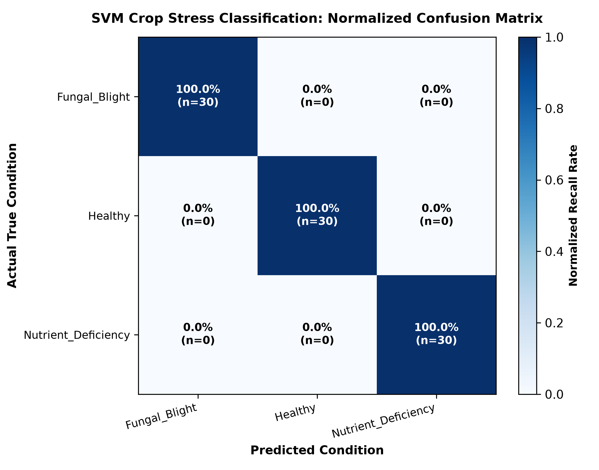
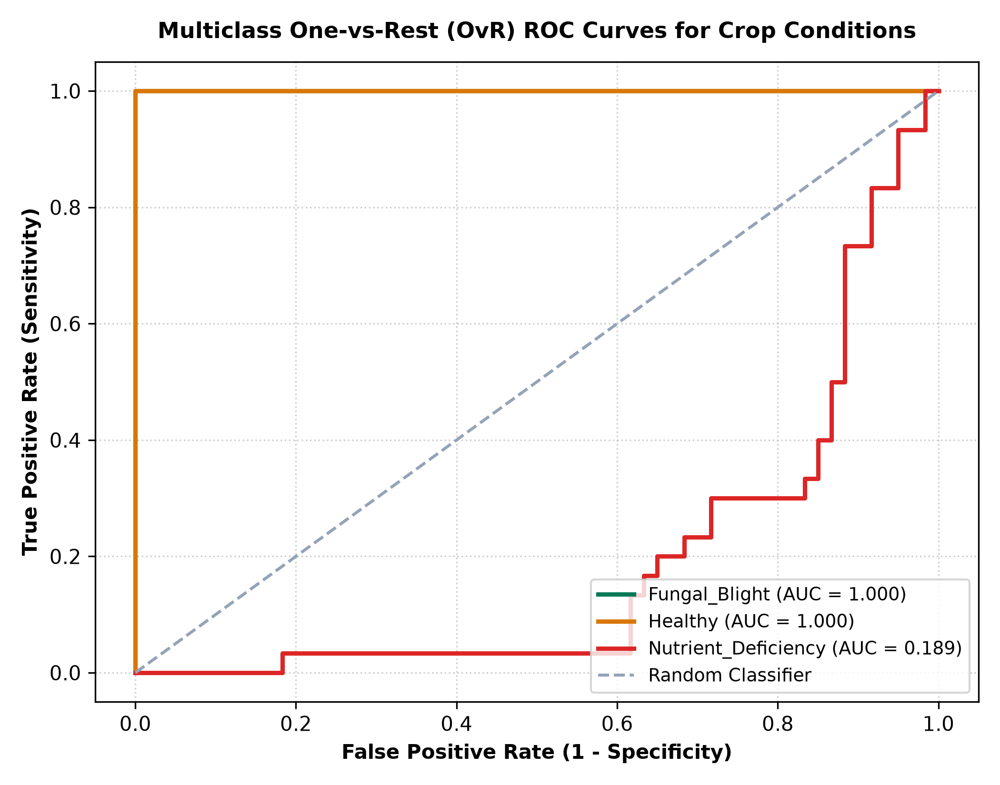

# 🌱 Support Vector Machines (SVM) for Agricultural Classification

[](https://www.python.org/)
[](https://www.r-project.org/)
[](plots/interactive_dashboard.html)
[](LICENSE)

An open reference repository providing complete implementations, diagnostic figures, interactive **Plotly** dashboards, and tutorials for **Support Vector Machine (SVM)** classification in precision agriculture and crop phenomics.

---

## 📈 Visual Highlights & Model Diagnostics

### 1. Decision Boundaries & Support Vector Margins (Linear vs. RBF Kernel)
Comparison of linear and non-linear Radial Basis Function (RBF) kernel boundaries on standardized NDVI vs. Canopy Temperature, highlighting critical **Support Vectors** ($n$ points on margin boundaries):


### 2. Normalized Confusion Matrix Heatmap
Evaluating classification accuracy across Healthy, Nutrient Deficiency, and Fungal Blight conditions:



### 3. Hyperparameter Optimization Grid ($C$ vs. $\gamma$)
5-fold cross-validation accuracy surface across regularization penalty ($C$) and RBF kernel bandwidth ($\gamma$):


### 4. Multiclass One-vs-Rest (OvR) ROC Curves
Receiver Operating Characteristic curves with Area Under Curve (AUC) metrics for each crop condition:



---

## 🌐 Interactive Dashboards (Plotly HTML)

Explore the models interactively in any web browser:

1. **[Interactive Phenomics Dashboard](plots/interactive_dashboard.html)**:
   - Dynamic confusion matrix with hover counts and percentages.
   - Precision, Recall, and F1-score comparisons per class.
   - Interactive 2D scatter plot with condition filters.
   - Chlorophyll SPAD distribution box plots.
2. **[Interactive 3D Phenomics Space](plots/interactive_3d_scatter.html)**:
   - Rotatable 3D scatter plot of NDVI, Canopy Temperature, and SPAD Chlorophyll.

---

## 📁 Repository Structure

```text
├── data/
│   └── crop_disease_phenomics.csv    # 360 field observations across 3 crop health conditions
├── notebooks/
│   └── agri_svm_walkthrough.ipynb    # Step-by-step interactive tutorial notebook
├── plots/
│   ├── svm_decision_boundaries.png   # Linear vs RBF decision boundaries with support vectors
│   ├── confusion_matrix.png          # Normalized confusion matrix heatmap
│   ├── hyperparameter_gridsearch.png # C vs Gamma cross-validation accuracy heatmap
│   ├── roc_ovr_curves.png            # Multiclass One-vs-Rest ROC curves
│   ├── interactive_dashboard.html    # Standalone interactive Plotly dashboard
│   └── interactive_3d_scatter.html   # Rotatable 3D phenomic feature space
├── python/
│   ├── agri_svm_classification.py    # Core SVM pipeline with cross-validation and diagnostics
│   ├── generate_plots.py             # Script to regenerate static 300 DPI figures
│   └── generate_interactive_plots.py # Script to rebuild interactive Plotly HTMLs
├── R/
│   └── agri_svm_classification.R     # R implementation leveraging e1071 / kernlab
├── requirements.txt                  # Python dependencies
└── README.md
```

---

## 🚀 Quickstart

### 1. Python Setup
```bash
git clone https://github.com/lunganlungpg/agri-svm-classification.git
cd agri-svm-classification
pip install -r requirements.txt
```

### 2. Run the Core SVM Pipeline
```bash
python python/agri_svm_classification.py
```

### 3. Generate All Visualizations & Dashboards
```bash
# Render static 300 DPI figures
python python/generate_plots.py

# Build interactive Plotly dashboards
python python/generate_interactive_plots.py
```

### 4. Run the R Pipeline
```bash
Rscript R/agri_svm_classification.R
```

---

## 📊 Dataset Fields (`crop_disease_phenomics.csv`)
- `ndvi`: Normalized Difference Vegetation Index (canopy greenness and vigor).
- `ndre`: Normalized Difference Red Edge Index (early chlorophyll stress indicator).
- `canopy_temp_c`: Thermal infrared canopy temperature ($^\circ\text{C}$).
- `chlorophyll_spad`: Soil-Plant Analyses Development (SPAD) chlorophyll index.
- `leaf_moisture_pct`: Relative leaf water content percentage.
- `condition`: Target classification label (`Healthy`, `Nutrient_Deficiency`, `Fungal_Blight`).

---

## 📄 License
Released under the [MIT License](LICENSE).
